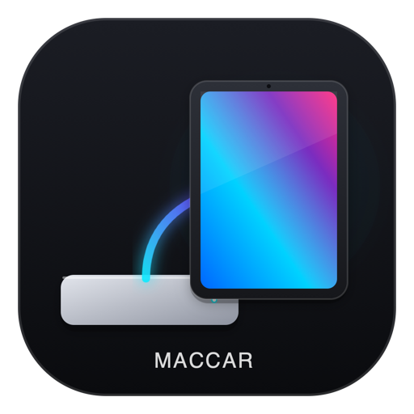
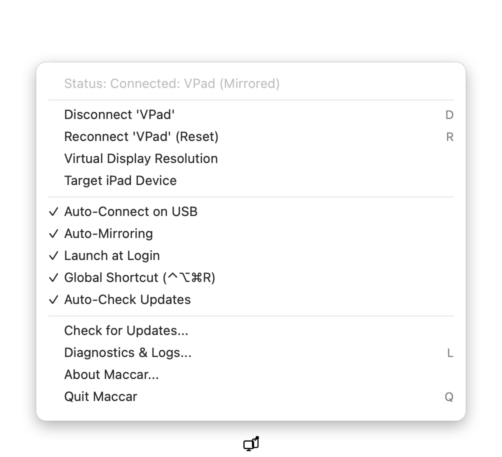
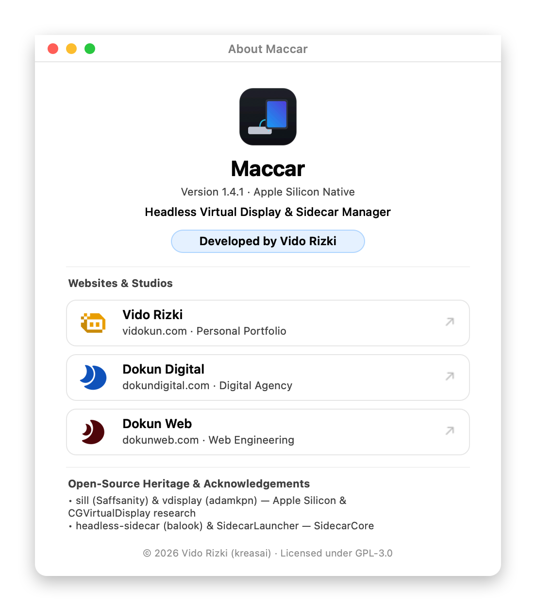
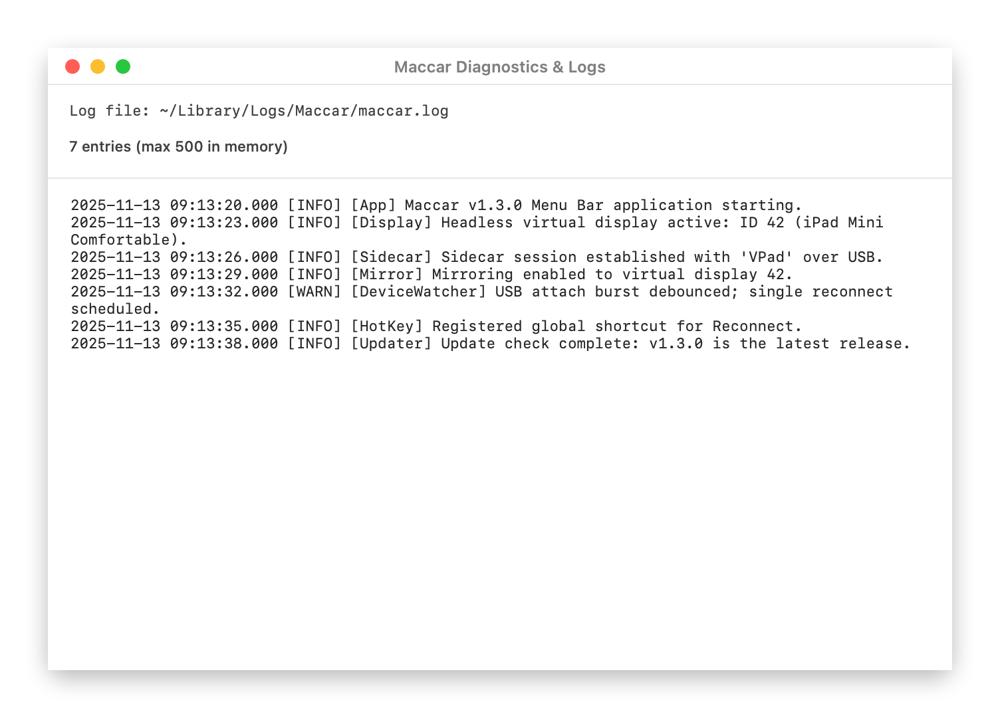

<div align="center">
  
  <h1>Maccar</h1>
  <p><strong>Running a headless Mac mini without a monitor? Turn your iPad into a primary Retina display.</strong></p>
  <p>
    <a href="LICENSE"></a>
    
    <a href="https://github.com/vidokun/Maccar/releases/latest"></a>
  </p>
  <p>
    <a href="#english">English</a> |
    <a href="#bahasa-indonesia">Bahasa Indonesia</a> |
    <a href="#install">Install</a> |
    <a href="#screenshots">Screenshots</a> |
    <a href="#support">Support</a>
  </p>
</div>

---

## English

Maccar is a native macOS Menu Bar app for **Headless Sidecar** workflows on macOS 14+.

Apple blocks **Sidecar without monitor** hardware, so a **Mac mini headless iPad display** normally requires an HDMI dummy plug. Maccar creates a Retina `CGVirtualDisplay` screen in macOS memory instead. Connect your iPad over USB-C or Wi-Fi and it mirrors automatically.

### What Maccar Fixes

- Creates a crisp HiDPI virtual display in memory without dummy HDMI hardware.
- Switches resolutions in place with `CGConfigureDisplayWithDisplayMode` after checking `CGDisplayModeIsUsableForDesktopGUI`, keeping active sessions alive.
- Hides unsupported resolutions automatically from the Menu Bar list so switching never fails.
- Reconnects automatically on USB-C attach (`750ms` IOKit wake-up) while pausing `-200` retry storms when an iPad is asleep.
- Respects manual disconnects until you click Reconnect or press `⌃⌥⌘R` (`⌃⌥⇧⌘R` fallback if claimed by another app).
- Syncs `Launch at Login` via `.app`-guarded `SMAppService.mainApp` registration and shows macOS approval guidance when needed.
- Delivers verified updates inside the Menu Bar via `Check for Updates...` (`Auto-Check Updates` enabled by default).
- Captures rotating runtime diagnostics (`512 KB` cap) viewable in **Diagnostics & Logs...**.

---

## Install

> **No release has been published yet.** The paths below are the supported ones, but they
> resolve only once a `v*` tag has run the release workflow. Until then `releases/latest/...`
> returns 404 and the installer exits without installing anything. Build from source in the
> meantime: `./maccar.sh build`.

### Option 1: One-Line Terminal Installer (Zero Xcode Tools Needed)

Run the verified installer script in Terminal. It checks macOS 14+, verifies `SHA-256` and `codesign` integrity, and installs `/Applications/Maccar.app`:

```sh
curl -fsSL https://raw.githubusercontent.com/vidokun/Maccar/main/install.sh | sh
```

You can also inspect before installing with `--dry-run`, pin a release with `--version`, or pick another folder with `--prefix`:

```sh
curl -fsSL https://raw.githubusercontent.com/vidokun/Maccar/main/install.sh | sh -s -- --version 1.4.0 --prefix ~/Applications --dry-run
```

### Option 2: Download DMG & Auto-Update

Download the latest disk image directly from [Maccar.dmg](https://github.com/vidokun/Maccar/releases/latest/download/Maccar.dmg). Drag `Maccar.app` into `Applications` and open it.

Once installed, open the Menu Bar icon and click **Check for Updates...** to pull a verified release.

---

## Screenshots

<table>
  <tr>
    <td align="center">
      <br />
      <sub>Menu Bar status, resolutions, and update controls</sub>
    </td>
    <td align="center">
      <br />
      <sub>About window with GPL-3.0 attribution</sub>
    </td>
    <td align="center">
      <br />
      <sub>Rotating diagnostics viewer and log tools</sub>
    </td>
  </tr>
</table>

---

## Display Presets

Maccar ships with curated Retina and 16:9 presets. Any preset not marked usable for desktop GUI on the active display is filtered out automatically.

| Device / Group | Available Presets |
|---|---|
| Auto | `auto` (matches connected iPad aspect ratio) |
| iPad Mini 6 / 7 (8.3") | `1440x946` Comfortable, `1600x1050` Balanced, `1280x840` Large Text, `2266x1488` Max Space |
| iPad Air / 10th Gen (10.9") | `1440x1000` Comfortable, `2360x1640` Max Space |
| iPad Pro 11" | `1440x1006` Comfortable, `2388x1668` Max Space |
| iPad Pro 12.9" / 13" | `1600x1200` Comfortable, `2732x2048` Max Space |
| iPad 4:3 (9.7" / Mini 1-5) | `1366x1024` Comfortable, `2048x1536` Max Space |
| Standard 16:9 | `1920x1080` (1080p), `2560x1440` (1440p), `3840x2160` (4K) |

Every preset is reachable from **Virtual Display Resolution** in the Menu Bar. The list filters itself to the modes the active display actually supports, so an unusable preset never appears and a switch never fails.

### Reporting a Problem

Open the Menu Bar menu and click **Copy Diagnostics**, then paste the result into an issue. The report carries the app version and build, macOS version, launch-at-login state, reachable and connected iPads, mirror status, and the log path — with your home directory shortened to `~/` so nothing personal is included.

Active logs write to `~/Library/Logs/Maccar/maccar.log` and rotate to `~/Library/Logs/Maccar/maccar.log.1` at `512 KB`; open them with **Diagnostics & Logs...**.

---

## Bahasa Indonesia

### Mac mini tanpa monitor bikin Sidecar nggak bisa nyala? Colok iPad kamu, langsung jadi layar Retina utama.

Menjalankan Mac mini tanpa monitor biar Sidecar bisa nyala biasanya kayak nyalain mobil tanpa setir: harus beli colokan HDMI dummy dulu baru layarnya kebaca. Maccar bikin layar virtual langsung di memori macOS, jadi iPad langsung kebaca begitu kabel USB-C dicolok.

Workflow **Sidecar tanpa monitor** untuk **Mac mini headless iPad display** langsung jalan lewat kabel USB-C maupun Wi-Fi tanpa dongle tambahan.

### Fitur Utama Buat Setup Headless

- Bikin layar virtual `CGVirtualDisplay` beresolusi Retina langsung di memori macOS tanpa colokan HDMI dummy.
- Ganti resolusi langsung di tempat pakai `CGConfigureDisplayWithDisplayMode` setelah validasi `CGDisplayModeIsUsableForDesktopGUI`, jadi sesi iPad tidak putus.
- Filter daftar resolusi secara otomatis agar preset yang tidak cocok dengan layar virtual tidak muncul di Menu Bar.
- Jeda otomatis saat `-200` berulang ketika iPad sedang tidur, lalu langsung bangun lagi saat kabel USB dicolok ulang (`750ms` IOKit attach hook).
- Tekan shortcut global `⌃⌥⌘R` kapan saja buat reset koneksi Sidecar dan sinkronisasi mirror ulang.
- Sinkronisasi `Launch at Login` lewat `SMAppService.mainApp` khusus bundle `.app`, lengkap dengan arahan persetujuan macOS bila diperlukan.
- Update aplikasi langsung dari Menu Bar lewat tombol **Check for Updates...** atau cek log aktif di **Diagnostics & Logs...**.

### Dua Cara Pasang di macOS 14+

#### Install

> **Belum ada rilis yang dipublikasikan.** Kedua cara di bawah adalah jalur resmi, tetapi baru
> berfungsi setelah tag `v*` menjalankan workflow rilis. Sampai saat itu `releases/latest/...`
> mengembalikan 404 dan installer berhenti tanpa memasang apa pun. Sementara ini, build dari
> source: `./maccar.sh build`.

1. Lewat Terminal (otomatis cek `SHA-256` dan `codesign`, tanpa perlu Xcode):

   ```sh
   curl -fsSL https://raw.githubusercontent.com/vidokun/Maccar/main/install.sh | sh
   ```

   Tambahkan `--dry-run` untuk simulasi cek, `--version` untuk memilih versi, atau `--prefix` untuk folder tujuan lain.

2. Lewat file `.dmg`: unduh [Maccar.dmg](https://github.com/vidokun/Maccar/releases/latest/download/Maccar.dmg), pindahkan `Maccar.app` ke folder `Applications`, lalu buka seperti biasa. Pembaruan berikutnya cukup lewat **Check for Updates...** di Menu Bar.

### Melaporkan Masalah

Buka menu Menu Bar lalu klik **Copy Diagnostics**, kemudian tempel hasilnya ke issue. Laporan itu berisi versi dan build aplikasi, versi macOS, status Launch at Login, iPad yang terdeteksi dan terhubung, status mirror, serta lokasi log — dengan folder home dipersingkat jadi `~/` supaya tidak ada data pribadi yang ikut.

---

## Support

### Donate & Support

If Maccar saves you from buying dummy hardware, support ongoing development directly on Trakteer:

[Support Maccar on Trakteer (trakteer.id/vidokun/tip)](https://trakteer.id/vidokun/tip)

---

## Credits & Author

Maccar builds on open-source CoreGraphics and Sidecar research from the macOS community:

| Project | Contribution |
|---|---|
| [Saffsanity/sill](https://github.com/Saffsanity/sill) | Apple Silicon headless virtual display and iPad workflow inspiration |
| [adamkpn/vdisplay](https://github.com/adamkpn/vdisplay) | Foundational private CoreGraphics `CGVirtualDisplay` bridging patterns |
| [balook/headless-sidecar](https://github.com/balook/headless-sidecar) & SidecarLauncher | `SidecarCore.framework` private API exploration |

Built by **Vido Rizki**: [vidokun.com](https://vidokun.com) | [dokundigital.com](https://dokundigital.com) | [dokunweb.com](https://dokunweb.com)

Licensed under the GNU General Public License v3.0 (GPL-3.0). See [LICENSE](LICENSE).
